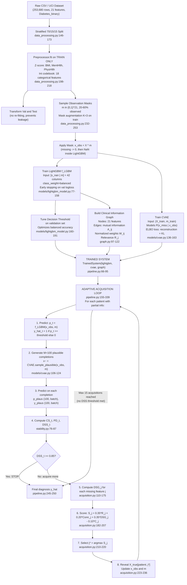

# 03 — Understanding My Diabetes Risk Prediction System from Start to Finish

---

## Architecture Flowchart (Actual Implementation)

---

## Stage-by-Stage Explanation of the ACTUAL Pipeline

---

### STAGE 1: Data Loading and Splitting

**What enters:** Nothing yet — the stage loads data from the CDC BRFSS public survey.

**What happens inside:**
- `load_raw_dataframe()` fetches the dataset from UCI ML Repository (ID 891) or reads a local CSV.
- `train_val_test_split()` performs a stratified split: 70% training, 15% validation, 15% test.
- "Stratified" means the ~13.9% positive class fraction is preserved in all three splits.

**What comes out:** Three separate DataFrames (train, val, test).

**Why necessary:** We must never evaluate on data the model has seen during training. The three-way split ensures the test set is completely held out.

**Source file:** `data_processing.py:146-173`

**Analogy:** Imagine shuffling a deck of cards and dealing 70 to a student to learn from, 15 to use for practice quizzes, and keeping 15 face-down as the final exam.

**Numerical example:** If dataset has 253,680 rows → train=177,576, val=38,052, test=38,052.

**What could go wrong:** Fitting the normalization on the whole dataset (including val/test) would create data leakage — the model would have "seen" val/test statistics during training.

**What to say to the examiner:** "We use a stratified 70/15/15 split. Stratified means each split preserves the natural class ratio of about 86% non-diabetic and 14% diabetic. The test set is held out until final evaluation — we never use it during training or threshold selection."

---

### STAGE 2: Preprocessing

**What enters:** Raw DataFrames from each split.

**What happens inside:**
- `Preprocessor.fit()` is called on the TRAINING split only.
- For 3 continuous features (BMI, MentHlth, PhysHlth): z-score standardization `z = (x - mu) / (sigma + eps)` where mu and sigma come from training data.
- For 18 categorical/ordinal features: integer codebook mapping (e.g., HighBP: {0.0: 0, 1.0: 1}).
- `Preprocessor.transform()` applies the fitted parameters to val and test — it does NOT refit.

**What comes out:** Numeric numpy arrays X_train, X_val, X_test of shape (N, 21).

**Why necessary:** LightGBM and CVAE need numeric inputs. Z-scoring prevents features with large ranges (BMI, MentHlth) from dominating the model.

**Source file:** `data_processing.py:179-218`

**Analogy:** Measuring everything in the same unit. BMI ranges from 10 to 80; MentHlth ranges from 0 to 30. After z-scoring, both have mean 0 and standard deviation 1.

**Numerical example:** BMI raw value 35; training mu_BMI=28.4, sigma_BMI=6.6 → z_BMI = (35-28.4)/6.6 = 1.0. A BMI of 1.0 standard deviations above average.

**What could go wrong:** If you fit the preprocessor on the full dataset (including test), then the test set statistics "leak" into training. The model would perform artificially well because it was tuned to statistics that include the test distribution.

**What to say to the examiner:** "The Preprocessor is fit exclusively on the training split. We then apply the same mean and standard deviation to transform the validation and test sets. This prevents any form of statistical leakage from evaluation data into the training process."

---

### STAGE 3: Observation Mask Generation

**What enters:** The preprocessed feature matrices X_train, X_val, X_test.

**What happens inside:**
- `sample_observation_masks()` creates binary masks m in {0,1}^21, one row per patient.
- For each patient: uniformly sample a fraction f in [0.20, 0.60], then randomly choose k = round(f * 21) features to observe (m_j = 1); the rest are missing (m_j = 0).
- Independent random number generators are used for train, val, and test masks.
- On training: mask augmentation tiles each patient K=3 times with different mask patterns.

**What comes out:** Binary mask arrays m_train, m_val, m_test.

**Why necessary:** The CDC BRFSS dataset does not have naturally missing values — all respondents answered all 21 survey questions. We synthetically introduce missingness to simulate the real-world scenario where a clinician has only partial information.

**Source file:** `data_processing.py:232-262`

**Analogy:** Imagine a patient coming to the emergency room. A nurse has time to ask only 8 of the 21 health questions before the doctor needs to make a preliminary assessment. The mask tells us which 8 were asked.

**Numerical example:** Patient A: f=0.38, k=round(0.38*21)=8. Randomly chosen observed features: [HighBP, BMI, Smoker, GenHlth, Age, Income, PhysHlth, DiffWalk]. m = [1,0,0,1,1,0,0,0,0,0,0,0,0,1,0,1,1,0,1,0,1] (1=observed, 0=missing).

**What could go wrong:** If val and test use the same RNG seed as train, masks would be correlated. The independent RNG streams (sequential master_rng in prepare_dataset) prevent this.

**What to say to the examiner:** "The original CDC BRFSS dataset has no missing values because respondents completed the survey. We simulate clinical partial observability by applying synthetic random masks. This is a common approach in the active feature acquisition literature. We acknowledge this is a limitation — the system has not been validated on real EHR data with naturally missing values."

---

### STAGE 4: LightGBM Classifier Training

**What enters:** Masked training data X_obs_train = X_train * m_train, plus masks m_train, plus labels y_train. Validation data for early stopping.

**What happens inside:**
- `_prepare_features()` builds a 42-column augmented matrix [x_nan | m]:
  - x_nan: unobserved entries (m_j=0) are set to np.nan; observed entries keep their value.
  - m: the 21 binary mask columns are appended.
- LGBMClassifier is trained with class_weight="balanced" (handles 86%/14% imbalance).
- Early stopping monitors binary_logloss on validation; stops if no improvement for 30 rounds.
- `tune_threshold()` sweeps 91 candidate thresholds in [0.05, 0.95] on validation, selecting the one that maximizes balanced accuracy.

**What comes out:** Fitted LightGBMClassifierWrapper with a best_threshold_ attribute.

**Why necessary:** A classifier that sees only the observed features would conflate "feature is zero" with "feature is missing." By encoding missing entries as NaN and providing the mask explicitly, the model can learn distinct behavior for each case. LightGBM handles NaN natively by learning which side of each split NaN values should fall.

**Source file:** `models/lightgbm_model.py:38-191`

**Analogy:** A doctor who knows which test results are missing is more informed than one who assumes missing results are normal. The mask tells the model "I didn't measure this, it's not necessarily 0."

**Numerical example:** Patient A from above (8 observed features). x_nan column for HighChol is np.nan (not observed). m column for HighChol is 0. LightGBM can create splits like "if HighChol is NaN (not measured), go left; if HighChol=1, go right."

**What could go wrong:** Without the mask column, a zero-imputed missing value for HighBP (= 0) would be indistinguishable from a true observed reading of HighBP=0 (no high blood pressure). This would systematically bias predictions.

**What to say to the examiner:** "LightGBM receives a 42-dimensional input: the 21 feature values with missing entries encoded as NaN, concatenated with the 21 binary mask indicators. This dual representation lets the model learn both from observed clinical values and from the pattern of what was measured. The decision threshold is tuned on the validation set to optimize balanced accuracy, which is important given the class imbalance."

---

### STAGE 5: CVAE Training

**What enters:** Full training features X_train (unmasked ground truth) and masks m_train.

**What happens inside:**
- The Encoder `q(z | x, m)` takes x, m, and x_obs = x*m concatenated (3F = 63 inputs) and outputs (mu, logvar) for a latent Gaussian distribution z.
- The Decoder `p(x | z, x_obs, m)` takes z, x_obs, and m (latent_dim + 2F inputs) and reconstructs the full feature vector x_hat.
- The reparameterization trick: z = mu + eps * exp(0.5 * logvar), where eps ~ N(0,1).
- ELBO loss: MSE reconstruction (for both observed and missing features) + beta * KL divergence.
- At inference: only the decoder is used. z ~ N(0,1) is sampled randomly; decoder produces x_hat conditioned on x_obs and m.
- Identity constraint: x_plausible = x_obs * m + x_hat * (1-m). Observed values are NEVER changed.

**What comes out:** Trained CVAETrainer that can generate M plausible completions for any patient.

**Why necessary:** To compute class stability and predictive divergence, we need to know how the model's prediction would change under different plausible values for the missing features. The CVAE generates diverse, statistically plausible alternatives.

**Source file:** `models/cvae.py:31-183`

**Analogy:** "Imputing" missing values for uncertainty analysis. If we don't know a patient's cholesterol level, the CVAE generates 100 different plausible cholesterol values based on what we do know — age, BMI, blood pressure — and shows us how the prediction varies across those possibilities.

**Numerical example:** For Patient A (HighChol is missing):
- CVAE draws z1, z2, ..., z100 independently from N(0,I).
- For each z_m, decoder produces x_hat_m (all 21 features).
- Identity constraint: x_plausible_m = x_obs * m + x_hat_m * (1-m).
- HighChol takes value from x_hat_m; observed features (HighBP, BMI, etc.) remain unchanged.

**What could go wrong:** If the CVAE does not honor the identity constraint, it might alter observed feature values, producing implausible profiles where known facts about the patient are contradicted.

**What to say to the examiner:** "The CVAE is a conditional generative model that learns P(x_missing | x_observed). At inference, we fix all observed feature values and only generate plausible values for the missing features. The model was trained with full ground-truth data — during training, it sees x, m, and x*m simultaneously. At inference, only the decoder is used: we sample a latent code z from the prior N(0,I) and decode to get a plausible completion. Observed values are preserved exactly."

---

### STAGE 6: Clinical Information Graph Construction

**What enters:** Unmasked training features X_train_orig and labels y_train_orig.

**What happens inside:**
- `_mutual_info_association(X)`: for every pair (i, j) of features, estimates mutual information using 10-bin histogram discretization. Result: (21, 21) symmetric matrix A.
- `build_clinical_graph()`: normalizes A to get W = (A - min)/(max - min + eps); fills diagonal with 0.
- Computes feature relevance R_j = MI(X_j, y) for each of 21 features.
- Returns ClinicalGraph dataclass with A, W, R, R_norm.

**What comes out:** ClinicalGraph object used during acquisition scoring.

**Why necessary:** The graph captures which features are statistically associated with each other. When deciding which feature to acquire next, knowing that a candidate feature is highly correlated with already-observed features (high connectivity) tells us it might provide complementary information.

**Source file:** `graph.py:97-122`

**Important distinction:** The graph is based on **mutual information (statistical association)**, not causal relationships. High MI between HighBP and HighChol means knowing one tends to tell us about the other — but this does not mean one CAUSES the other.

**What to say to the examiner:** "The clinical graph has 21 nodes, one per feature. Edges are weighted by mutual information computed from the training data. The graph serves two purposes: it gives each feature a relevance score R_j measuring its statistical association with the diabetes label, and it gives a connectivity score Conn_j measuring how strongly a candidate feature is associated with the features we have already observed. This is statistical association, not causation — we would need a randomized controlled trial or causal inference methodology to establish causal direction."

---

### STAGE 7-11: Adaptive Acquisition Loop

**What enters:** Patient with initial observation (x_obs_0, m_0), trained LightGBM, CVAE, and graph.

**The loop (pipeline.py:195-315):**

**Step 1: Predict** (line 209-212)
- p_t = LightGBM.predict_proba_y1(x_obs, m) → scalar probability.
- y_hat_t = 1 if p_t >= best_threshold_ else 0.

**Step 2: Generate M plausible completions** (line 218)
- plausible = CVAE.generate_plausible_profiles(x_obs, m, M=100) → shape (100, batch, 21).

**Step 3: Predict on completions** (lines 228-232)
- For each of 100 plausible profiles: p_plaus_m = LightGBM(profile, full_mask=1).
- y_plaus_m = threshold on p_plaus_m.

**Step 4: Compute CS_t, PD_t, DSS_t** (line 235-237)
- CS_t = fraction of 100 plausible predictions that agree with y_hat_t.
- PD_t = mean Jensen-Shannon divergence between p_t and each p_plaus_m.
- DSS_t = 0.5 * CS_t + 0.5 * (1 - PD_t).

**Step 5: Check stopping** (line 242)
- If DSS_t >= 0.85: STOP. Record final y_hat, p_t, DSS_t.

**Step 6: Compute DSG_j for missing features** (lines 265-278)
- For each missing feature j in the unobserved set:
  - Generate K=5 candidate values from the CVAE decoder.
  - For each candidate value, set x_j = candidate_value, m_j = 1.
  - Compute future DSS with this hypothetical new observation.
  - DSG_j = average future DSS - current DSS_t.

**Step 7: Score and select** (lines 293-302)
- S_j = 0.35*R_j + 0.20*Conn_j + 0.35*DSG_j - 0.10*C_j.
- j* = argmax S_j.

**Step 8: Acquire and update** (lines 307-314)
- x_obs[patient, j*] = X_true[patient, j*] (oracle reveal from ground truth).
- m[patient, j*] = 1.
- total_cost[patient] += per_feature_cost[j*].

**Repeat until DSS_t >= 0.85 or 15 acquisitions reached.**

**What to say to the examiner:** "The adaptive loop is the core contribution. At each step, we predict with what we know, generate 100 plausible completions for what we don't know, and measure how stable the prediction is across those completions. If it's stable enough (DSS >= 0.85), we stop. Otherwise, we compute how much DSS would improve if we acquired each missing feature, and we choose the one with the highest expected gain relative to its cost. The acquired value comes from X_true — in a real deployment, this would be an actual medical test result or EHR query."

---

## Running Illustrative Example (ILLUSTRATIVE ONLY — Not a Real Patient or Medical Recommendation)

**Illustrative Patient "Alpha" (fictional):**

Initial state: 21 features available; mask selects 8 as observed.

| Feature | True Value | Observed? | x_obs value |
|---------|-----------|-----------|-------------|
| HighBP | 1 (Yes) | YES | 1 |
| HighChol | 1 (Yes) | NO | 0 (masked) |
| BMI | 32.0 → z=0.55 | YES | 0.55 |
| GenHlth | 4 (Poor) | YES | 4 |
| Age | 9 (55-59) | YES | 9 |
| HeartDisease | 0 (No) | NO | 0 (masked) |
| PhysHlth | 10 → z=0.21 | NO | 0 (masked) |
| Income | 3 ($20-25k) | YES | 3 |
| ... (13 more) | ... | NO | 0 (masked) |

**Step 1:** LightGBM receives [x_nan | m] (42-column). Missing features have NaN in x_nan column and 0 in m column. Predicted probability: p_t = 0.61, y_hat_t = 1 (Diabetic).

**Step 2:** CVAE generates 100 plausible completions. For each, HighChol might be 0 or 1, HeartDisease might be 0 or 1, etc. Observed values (HighBP=1, BMI=0.55, GenHlth=4, Age=9, Income=3) remain fixed.

**Step 3:** Classify each of 100 completions. Suppose 91 predict y=1 (Diabetic), 9 predict y=0.

**Step 4:**
- CS_t = 91/100 = 0.91 (good — most completions agree with current prediction)
- PD_t = mean JS divergence ≈ 0.015 (small — probabilities are similar across completions)
- DSS_t = 0.5 * 0.91 + 0.5 * (1 - 0.015) = 0.455 + 0.4925 = 0.9475

**Step 5:** DSS_t = 0.9475 >= 0.85? YES → STOP. Final diagnosis: Diabetic (y_hat=1, p_t=0.61). Zero features acquired in this iteration.

If CS_t were 0.65 (many completions disagree), DSS would be lower and the loop would continue, identifying the most informative missing feature to acquire.

---

## Intended vs. Actual Implementation

| Reference Design | Actual Implementation |
|-----------------|----------------------|
| XGBoost + TabResNet ensemble | LightGBM only (XGBoost/TabResNet coded but not used) |
| Bayesian fusion weights p_t = w_XGB*p_XGB + w_TR*p_TR | Pass-through: p_t = p_LGBM (w_LGBM=1.0) |
| F separate autoregressive generators g_1..g_F | Single unified CVAE (joint modeling, one forward pass) |
| Real clinical test acquisition | Oracle simulation from X_true ground-truth matrix |
| Real hospital cost data | Hardcoded ordinal cost estimates (1-10 scale) |

---

## Two-Minute Explanation (Memorizable)

"My project addresses diabetes risk prediction when patient information is incomplete. We use the CDC Behavioral Risk Factor Surveillance dataset — 253,000 patients, 21 health indicators, about 14% diabetic.

The core problem: in practice, you rarely have all 21 measurements for a patient. Maybe you only know their blood pressure, BMI, and age. How do you make a reliable prediction with partial information, and how do you decide what to measure next?

Our solution has three components. First, a LightGBM classifier trained on partial observations — it receives both the available feature values and explicit indicators of which features are missing, so it can distinguish 'blood pressure is zero' from 'blood pressure was not measured.' Second, a Conditional Variational Autoencoder that generates one hundred plausible completions for the missing features, so we can measure prediction stability. Third, a Clinical Information Graph that captures statistical associations between features, used to guide which feature to acquire next.

The key metric is the Decision Sufficiency Score — a weighted combination of class stability (do the plausible completions agree with the current prediction?) and predictive distribution stability (are the probability values consistent?). If DSS is above 0.85, we stop and report the diagnosis. If not, we compute the expected DSS gain from acquiring each missing feature and choose the one with the best gain-to-cost ratio.

On a demo cohort of 30 test patients, the system achieves a mean DSS of 0.98, a 100% early-stop rate, and improves balanced accuracy from 0.83 to 0.86 with fewer than one additional measurement per patient on average. This is a research prototype — it is not clinically validated and should not be used for real medical decisions."
